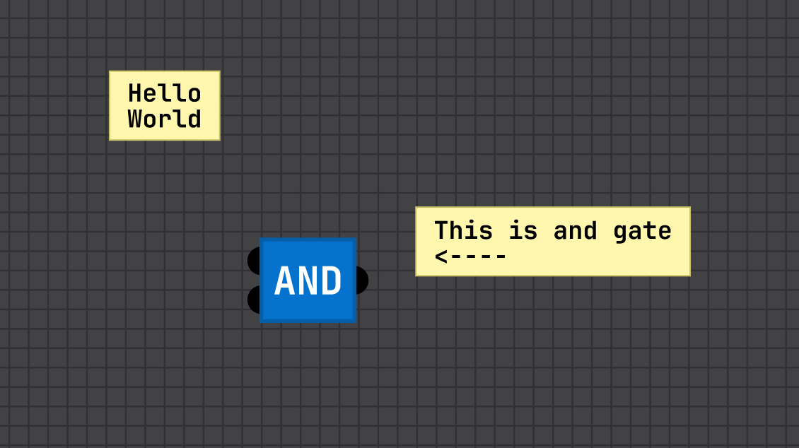
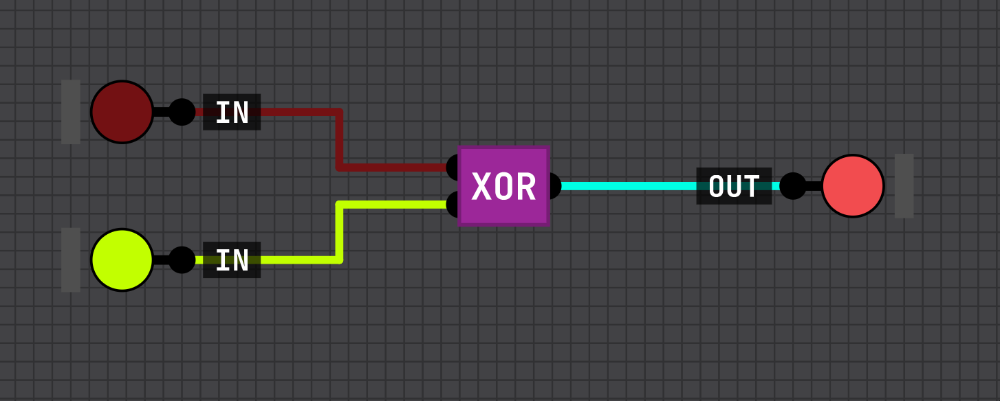
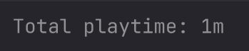
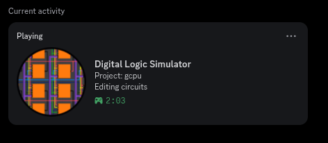

# Digital-Logic-Sim

This repo is fork from original [SebLague Digital-Logic-Sim](https://github.com/SebLague/Digital-Logic-Sim).

I just wanted to add few things. 

## AI Notice

All of my additions were vibecoded, I dont use Unity, I dont like unity, so expect many problems.

# Additions

## Notes

## Full RGB wire colors

## Playtime

## Discord Rich Presence

# Info
Just info I would find useful before doing this

- Projects are saved at `~/.config/unity3d/SebastianLague/Digital-Logic-Sim/Projects`
- Unity version: `6000.0.46f1`
